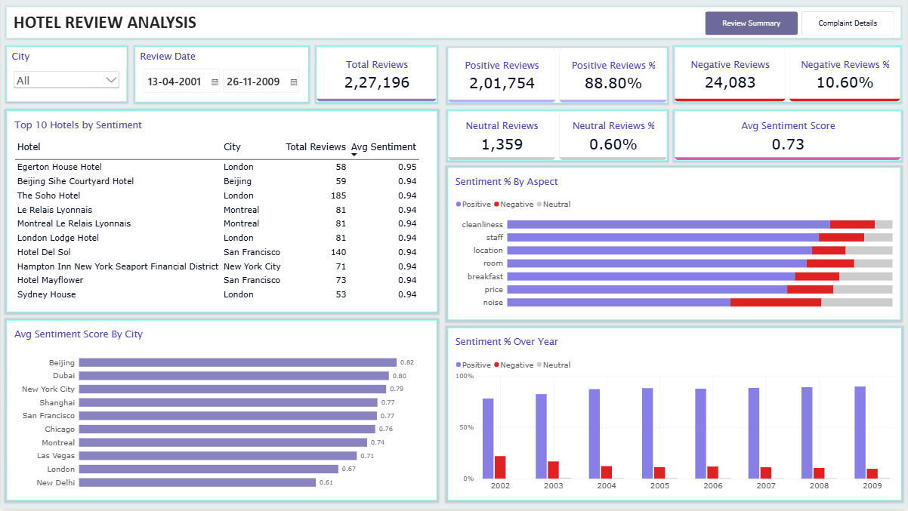
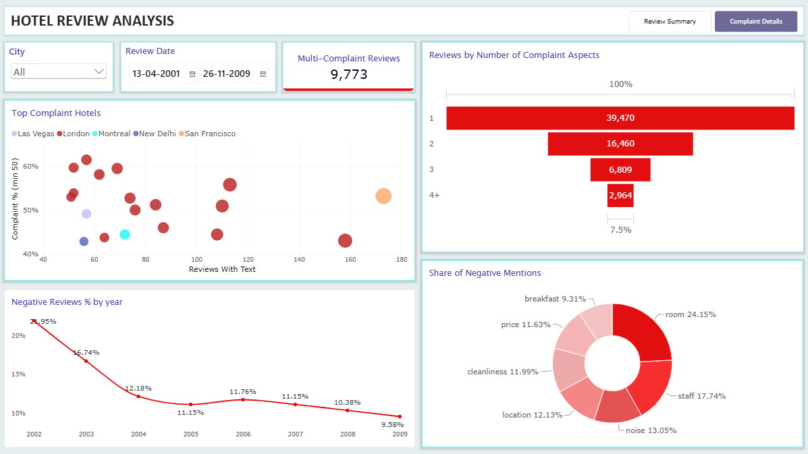

# Hotel Review Analytics Pipeline

An end-to-end pipeline that turns messy, unstructured hotel review text into
structured sentiment and aspect-level insights, loaded into MySQL and
visualized in Power BI.

## Dataset

Hotel reviews from the [OpinRank Review Dataset](http://www.kavita-ganesan.com/entity-ranking-data)
by Kavita Ganesan, collected from TripAdvisor. That page is the HTML version
of the dataset documentation. The full dataset also includes car reviews from
Edmunds (~42,230 reviews, model years 2007 to 2009), which this project does
not use.

**As documented**

- **Size:** about 259,000 hotel reviews.
- **Cities (10):** Dubai, Beijing, London, New York City, New Delhi,
  San Francisco, Shanghai, Montreal, Las Vegas, Chicago.
- **Layout:** one folder per city and one file per hotel. The filename is
  the hotel name.
- **Format:** one review per line, with tab-separated fields:
  `date<TAB>review title<TAB>full review`.
- **Fields:** date, review title, and full review text only. There are no
  star ratings or author names.

**As loaded in this project**

- 254,569 reviews from 2,567 hotels across the same 10 cities, after
  ingestion and cleaning. This is slightly below the documented total, which
  is approximate, and malformed lines are logged and skipped.
- 228,783 of them have review text and are used for sentiment analysis (see
  [Data notes and limitations](#data-notes-and-limitations)).
- City and hotel name come from the folder and file names, since they are not
  fields in the review lines.

**Citation**

The dataset's authors ask users to cite:

> Kavita Ganesan and ChengXiang Zhai, "Opinion-Based Entity Ranking",
> *Information Retrieval*, 2011.
> [doi:10.1007/s10791-011-9174-8](https://doi.org/10.1007/s10791-011-9174-8)

<details>
<summary>BibTeX</summary>

```bibtex
@article{opinrank,
  title   = {Opinion-Based Entity Ranking},
  journal = {Information Retrieval},
  year    = {2011},
  keywords = {adhoc multifaceted search, entity oriented search,
              entity ranking, entity retrieval, product search},
  doi     = {10.1007/s10791-011-9174-8},
  author  = {Kavita Ganesan and ChengXiang Zhai}
}
```

</details>

## Dashboard

### Review Summary



Overall sentiment KPIs, top 10 hotels by sentiment (hotels with 50+ reviews),
average sentiment by city, sentiment split by aspect, and sentiment by year.
Filters: city and review date.

### Complaint Details



Where complaints come from: hotels with the highest complaint rates (50+
reviews), how many complaint aspects a single review contains, each aspect's
share of negative mentions, and the negative review rate by year. Filters:
city and review date.

Power BI file: [`powerbi/hotel_review_dashboard.pbix`](powerbi/hotel_review_dashboard.pbix).
Open it in Power BI Desktop and point it at your own MySQL database.

## Pipeline stages

1. **Ingestion** (`src/data_ingestion.py`): walks the raw dataset folders
   (one per city, one file per hotel), parses tab-separated review lines,
   handles inconsistent encodings, and logs malformed rows instead of
   silently dropping data.
2. **Cleaning** (`src/data_cleaning.py`): decodes HTML entities, strips
   encoding artifacts, standardizes whitespace, parses review dates, and
   removes exact duplicates.
3. **NLP** (`src/nlp_processing.py`): computes document-level sentiment
   (NLTK/VADER) per review, plus sentence-level aspect sentiment for
   room, staff, location, breakfast, price, cleanliness, and noise.
4. **Database load** (`src/db_loader.py`): creates a MySQL schema
   (`hotels`, `reviews`, `review_aspects`) and loads the processed data.
5. **SQL analysis** (`sql/hotel_review_analysis.sql`): data-quality checks
   (missing text, missing dates, `?` titles) and the queries behind each
   dashboard page.
6. **Power BI dashboard**: two pages, Review Summary and Complaint Details,
   built on the MySQL tables with DAX measures. Hotel names and country were
   further cleaned in Power Query.

## Key findings

- **Sentiment skews positive.** Of the 228,783 reviews with text, 88.8% are
  positive, 10.6% negative, and 0.6% neutral. The average sentiment score
  is 0.73.
- **Noise is the weakest aspect** (average aspect sentiment 0.23) and
  cleanliness the strongest (0.49).
- **Room, staff, and noise account for the most negative mentions** (24.2%,
  17.7%, and 13.1% of all negative aspect mentions). This share depends on how
  often an aspect is discussed as well as how negatively, which is why
  noise stands out when aspects are compared by sentiment score instead.
- **Complaints often sit inside positive reviews.** Only 10.6% of reviews
  are negative overall, but about 29% (65,703 reviews) mention at least one
  complaint aspect, and 9,773 reviews complain about three or more aspects.
- **Negative sentiment declined over time.** The share of negative reviews
  fell from 21.95% in 2002 to 9.58% in 2009. The earliest years are small
  samples: 2001 has 20 reviews and is left out of the year charts, and 2002
  has 728.
- **Cities differ.** Beijing has the highest average sentiment (0.82) and
  New Delhi the lowest (0.61), with London second lowest (0.67). The hotels
  with the highest complaint rates (50+ reviews, all above 40%) are mostly in
  London.

## Data notes and limitations

- **Title-only reviews.** 25,786 reviews (about 10%) have a title but no
  review text in the source files, even though the documentation lists the
  full review as a field. This was verified against the raw data. They stay
  in MySQL so source counts remain auditable, and are excluded from
  sentiment analysis and the Power BI model.
- **`?` titles.** 1,682 titles start with `?` because non-Latin characters
  are already stored as `?` in the raw files. It is not an encoding fault in
  the pipeline, and 1,680 of those reviews have no text anyway.
- **Trailing tab.** Review lines end with an extra tab, so each splits into
  four fields with the last one empty. The parser drops that empty field.
- **Missing dates.** 1,587 reviews have no date in the source. The Review
  Date slicer excludes them, which is why the dashboard cards show 227,196
  reviews instead of 228,783. The SQL queries include them.
- **No star ratings.** The dataset has none, so sentiment comes from the
  review text. VADER is lexicon-based and can miss sarcasm, and aspects are
  tagged by keyword matching on seven topics, so other wording is missed.

## Tech stack

Python, pandas, NLTK/VADER, MySQL, SQLAlchemy, SQL, Power BI, DAX

## Project structure

```
├── config/            # Centralized paths, constants, DB config
├── loggers/           # Shared logging configuration
├── src/               # Production pipeline scripts
│   ├── data_ingestion.py
│   ├── data_cleaning.py
│   ├── nlp_processing.py
│   └── db_loader.py
├── sql/               # MySQL analysis queries
│   └── hotel_review_analysis.sql
├── notebooks/         # Exploratory notebooks (one per pipeline stage)
├── powerbi/           # Power BI dashboard (.pbix) and page screenshots
├── data/              # Raw and processed data (not committed - see .gitignore)
├── logs/              # Runtime logs (not committed)
└── main.py            # Runs all pipeline stages end to end
```

## Setup

1. Clone the repo and create a virtual environment:
   ```
   python -m venv venv
   venv\Scripts\activate      # Windows
   pip install -r requirements.txt
   ```
2. Get the hotel reviews from the
   [OpinRank dataset page](http://www.kavita-ganesan.com/entity-ranking-data)
   and place the 10 city folders under `data/hotels/`.
3. Set your MySQL credentials as environment variables:
   ```
   $env:MYSQL_USER = "root"
   $env:MYSQL_PASSWORD = "your_password"
   ```
4. Run the full pipeline:
   ```
   python main.py
   ```
   or run each stage individually:
   ```
   python -m src.data_ingestion
   python -m src.data_cleaning
   python -m src.nlp_processing
   python -m src.db_loader
   ```
5. Run `sql/hotel_review_analysis.sql` in MySQL Workbench to reproduce the
   checks and dashboard numbers.

## Key design decisions

- **NLTK/VADER over a transformer model** for sentiment: fast enough to
  run on 250K+ reviews without a GPU, and well-suited to short, informal
  review text.
- **Sentence-level aspect sentiment**, not document-level. An earlier
  version scored aspects using whole-review sentiment, which incorrectly
  showed complaints (e.g. "noise") as positive whenever the rest of the
  review was upbeat. Splitting into sentences and scoring only the
  sentence(s) mentioning each aspect fixed this.
- **Filter, don't delete, title-only reviews.** They stay in the database
  and are excluded at query and model level, so every count can be traced
  back to the source.
- **Config-driven paths and constants** (`config/config.py`) instead of
  hardcoded values, so the pipeline runs consistently across machines.

## Status

Complete: ingestion, cleaning, NLP, MySQL loading, SQL analysis, and the
two-page Power BI dashboard.
